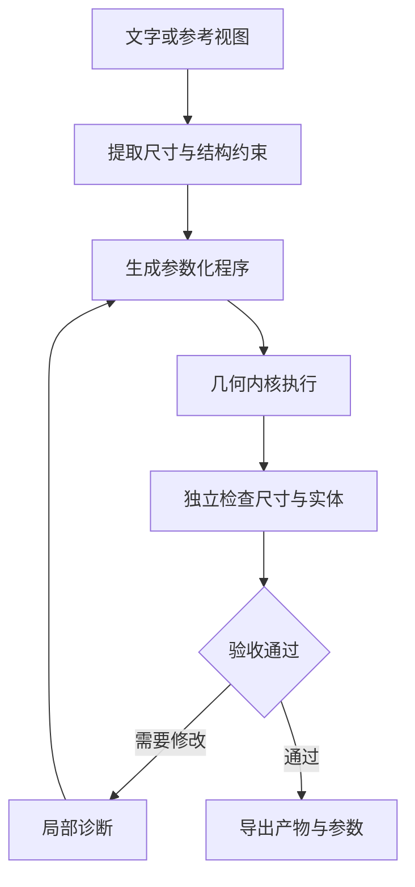

# Kimi K3.1 Pro 的 3D 能力：让建模结果接受程序验收

K3.1 Pro 的 3D 演示很容易让人先关注画面。对工程工作流，更值得分析的是：模型怎样把视觉信息转成参数和程序，怎样调用几何工具，以及怎样验证输出满足要求。

官方模型卡报告了 BenchCAD 的有工具与无工具结果，并注明评测使用抽样子集与不同执行设置。本文将这些结果作为研究入口，重点讨论可复现的建模闭环，不把演示画面当成机械零件已经合格的证明。

## 从“看起来像”走到“可以检查”

[BenchCAD 原始项目](https://github.com/BenchCAD/BenchCAD-main)将视觉到参数化程序的任务落到 CadQuery 上，并对执行后的实体进行几何评估。它提供了一种有用的任务拆法：图像理解、参数抽象、代码生成和实体执行，可以分别出错。

模型可能正确识别了一个垫圈，却把直径当成半径；也可能尺寸正确，但布尔运算失败；还可能实体几何近似，却不符合题目要求的可编辑结构。

因此，验收应跨越三个层次：程序能执行、几何满足约束、产物适合后续使用。三个层次之间没有自动等价关系。



## 用一个垫圈把问题讲清楚

设定一个本文构造的任务：外径 40 mm、内径 20 mm、厚度 8 mm，内外圆同心。这些数值不来自 Kimi 的生成案例。

先把需求变成参数，避免模型在多轮修改时悄悄改变单位或含义：

```json
{
  "unit": "mm",
  "outer_diameter": 40,
  "inner_diameter": 20,
  "height": 8,
  "concentric": true
}
```

对这个简单实体，我们有一个与生成程序相独立的解析检查：

$$
V=\frac{\pi}{4}(D^2-d^2)h
=2400\pi\ \text{mm}^3\approx7539.82\ \text{mm}^3
$$

体积检查不能证明所有几何都正确，但能快速发现一批单位和半径错误。还应检查包围盒为 $40\times40\times8$ mm、实体数量、同心关系与孔是否贯通。

下面的 Python 片段只做参数和解析体积验证，可独立运行：

```python
from math import pi

def reference_volume(outer_diameter, inner_diameter, height):
    if not (outer_diameter > inner_diameter > 0 and height > 0):
        raise ValueError("invalid dimensions")
    return pi / 4 * (outer_diameter**2 - inner_diameter**2) * height

assert abs(reference_volume(40, 20, 8) - 2400 * pi) < 1e-9
```

真实几何检查还需要读取生成实体。独立的解析参考和生成程序应分开维护，避免同一个错误同时污染“答案”和“验收”。

## 参数化程序提供了可修改的结构

参数化建模把尺寸、轮廓、拉伸和布尔运算表达为程序。相比只交付一张图，它能保留后续修改所需的入口。

例如，把厚度从 8 mm 改到 10 mm 时，理想的修改应集中在对应参数和受其影响的几何关系。外径、内径、材料设置和无关部件应保持不变。

这类局部编辑可以转化为回归约束：目标参数发生预期变化，其他关键尺寸保持不变，实体继续有效，导出文件能重新载入。模型每次获得的反馈，也就从“画面不太对”变成具体的差异。

交付时应同时保留参数、生成程序、工具版本、导出文件和验收报告。只有最终文件而没有生成路径，会让下一轮修改退化成重新猜测。

## 视觉反馈与几何反馈承担不同职责

截图适合发现构图、材质、比例和部件关系中的明显异常。几何检查适合发现孔径、厚度、实体数量、法向和拓扑问题。

| 反馈方式 | 更适合检查 | 容易漏掉 |
| --- | --- | --- |
| 多视角渲染 | 外观、相对位置、材质 | 精确尺寸、内部结构 |
| 尺寸与体积检查 | 单位、缩放、部分布尔错误 | 所有局部形状差异 |
| 实体与拓扑检查 | 断裂、自交、非封闭问题 | 设计意图是否正确 |
| 参数修改回归 | 可编辑性、约束传播 | 未列入回归的需求 |

建立闭环时，应把这些证据组合起来。一个漂亮的渲染结果，可能仍然需要进一步检查才能用于装配或加工；一个几何有效的实体，也未必符合用户想要的外观。

## 工具权限也是闭环的一部分

建模代码应在明确的工作目录和执行预算内运行。执行端可以允许创建模型、渲染和导出，同时限制对无关目录、网络和宿主环境的访问。

这种约束有两个实际收益：失败后更容易复现，输出的验收证据也更明确。工具可以返回结构化诊断，例如某次布尔运算失败、一个包围盒超出范围、某项导出缺失；模型再围绕这些诊断做局部修正。

不能把“工具可调用”直接理解为“可以任意执行模型生成的脚本”。执行环境、任务输入与验收器应有各自清楚的边界。

## 怎样阅读 K3.1 Pro 的 BenchCAD 数据

[官方模型卡](https://huggingface.co/moonshotai/Kimi-K3.1-Pro)报告 K3.1 Pro 无工具为 72.8、有工具为 92.7，并说明评估使用 1000 个样例的子集。这里包含工具、脚手架和执行设置的差异，不能把两个数字简单解释为一次严格控制变量的工具消融。

它更适合提示我们继续追问：模型得到哪些视图、允许多少次修改、工具反馈包含什么、失败的程序怎样计分、采用何种几何相似性，以及模型是否真的交付了可重用程序。

对自己的场景，也应先确定验收标准。展示级资产、可编辑 CAD、装配零件和可打印模型，对结果的要求不同。K3.1 Pro 的相关能力值得测试，而测试任务应该围绕自己的交付标准构造。

## 资料与后续阅读

- [BenchCAD 原始项目与评分说明](https://github.com/BenchCAD/BenchCAD-main)
- [BenchCAD Vision2Code 任务说明](https://github.com/BenchCAD/BenchCAD-main/blob/main/Vision2Code/README.md)
- [Kimi K3.1 Pro 模型卡及 BenchCAD 评测脚注](https://huggingface.co/moonshotai/Kimi-K3.1-Pro)
- 本系列：[联合强化学习与环境验收](/posts/kimi-k31-pro-joint-rl-agent) · [事实核验与证据账本](/posts/kimi-k31-pro-evidence-verification)

*资料核验于 2026-11-05。垫圈与验证代码为本文自造示例，不是 Kimi 实测结果。*
