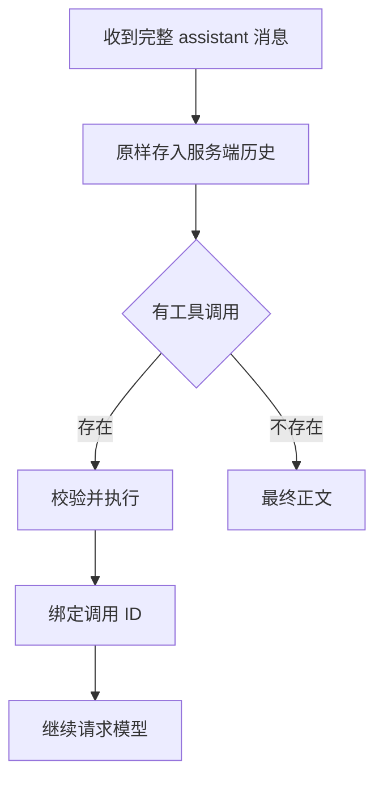

# 接入 Kimi K3.1 Pro：长上下文、思考消息与 Highspeed 的工程边界

模型接入之后，最容易被低估的是消息协议。单轮问答成功，只说明一次请求能够返回；长程 Agent 还要处理推理状态、工具调用、截断、预算和延迟。

本文根据 [Kimi K3.1 Pro 官方接入指南](https://platform.kimi.com/docs/guide/kimi-k3-1-pro-quickstart)梳理接口约束，并给出可以独立验证的消息保存方法。这里不使用付费请求冒充模型实测，延迟算例也不代表官方服务的实际表现。

## 先固定协议，再设计提示词

截至 2026-11-05，官方指南明确了以下约束：

| 项目 | 接入要点 |
| --- | --- |
| 模型名 | `kimi-k3.1-pro`、`kimi-k3.1-pro-highspeed` |
| 推理控制 | 始终启用思考；顶层 `reasoning_effort` 为 `low`、`high`、`max`，默认 `max` |
| 输出预算 | 使用 `max_completion_tokens`，默认 131072，上限 1048576 |
| 采样设置 | 温度等参数固定，按指南建议省略这些覆盖项 |
| 历史消息 | 完整回传 assistant 消息，不能只留下 `content` |
| 视觉输入 | 使用 base64 或 `ms://` 文件引用，不能直接传公网图片 URL |

这些是接口事实。一个旧客户端即使能正确发送 OpenAI 风格的 `messages`，也可能在推理参数、图片来源或历史消息处理上不符合这一模型的契约。

客户端应该把模型能力作为配置，而不是通过名称猜测。测试环境至少保存模型 ID、接口基址、请求参数、输入预算、工具 schema 版本与 SDK 版本，方便定位升级后的行为变化。

## 一条 assistant 消息可能同时承载几种内容

在工具工作流中，一次响应可能包含推理字段、工具调用和最终正文。只提取最终正文来存历史，会丢失下一轮请求需要的状态。



持久化对象和展示对象可以分开：服务端保留完整协议消息，界面按产品需求展示正文、工具状态或推理状态。界面为了简洁而隐藏一个字段，不应导致服务端历史也把它删掉。

下面的函数演示这种边界，使用普通字典，可离线运行：

```python
from copy import deepcopy

def record_assistant(history, message):
    if message.get("role") != "assistant":
        raise ValueError("expected assistant message")
    history.append(deepcopy(message))

sample = {
    "role": "assistant",
    "content": None,
    "reasoning_content": "demo reasoning state",
    "tool_calls": [{
        "id": "demo-call-1",
        "type": "function",
        "function": {"name": "lookup_note", "arguments": "{}"}
    }]
}
history = []
record_assistant(history, sample)
assert history[0] == sample
assert history[0] is not sample
assert history[0]["tool_calls"][0]["id"] == "demo-call-1"
```

这段代码只检验保存逻辑。实际执行端仍需验证工具名称、参数和权限，并把结果绑定到正确的调用 ID。不能用工具返回文本里的一句“已完成”，替代程序对副作用是否成功的确认。

## 给长上下文建立三层存储

一百万级上下文窗口提供了更大的输入空间，工作流仍需要挑选哪些材料进入本轮请求。建议把数据分成三层。

**原始材料层**保存完整文件、工具产物和必要的协议记录，能够按 ID 重新读取。**任务状态层**保存已经确认的目标、约束、决策、未解决问题与产物位置。**本轮上下文层**围绕当前步骤装配必要内容，同时为后续输出和工具返回预留余量。

这样做的好处是，把“能够回到原始材料”与“每轮都塞入全部原始材料”分开。长日志可以存成产物，当前请求只加入关键错误和读取入口；已经完成的阶段保留验收结果和摘要，必要时再回查细节。

如果压缩会话，需要遵守协议完整性：工具调用和对应结果应作为完整的一组处理。对官方要求保留的 assistant 消息，不能在保留一半结构的情况下随意截断。需要重新组织会话时，应通过明确的检查点和可追溯产物恢复任务状态。

## 将预算做成可观察的约束

本轮装配预算可以抽象为：

$$
B_{\text{context}}\geq
B_{\text{instructions}}+B_{\text{history}}+
B_{\text{materials}}+B_{\text{tools}}+B_{\text{reserved}}
$$

这是一种应用侧预算模型，实际计数应以服务端约束和 `usage` 为准。预留量要考虑输出、思考过程与可能新增的工具结果，不能把输入填到窗口边缘后再要求模型继续长时间工作。

更重要的是记录预算为什么被消耗：重复注入了哪些文件、哪些工具返回异常膨胀、哪些历史片段已经失去当前用途。只有总 token 数，没有来源分解，很难持续优化上下文管理。

## Highspeed 的收益取决于工作流时间分布

Kimi 的[发布介绍](https://www.kimi.com/news/kimi-k3-1-pro)将 Highspeed 描述为输出速度约为标准版的 2～3 倍。这是厂商对输出速度的说明，不足以推导任意 Agent 任务的整体提速。

把总耗时写为：

$$
T=T_{\text{queue}}+T_{\text{prefill}}+
T_{\text{decode}}+T_{\text{tools}}
$$

假设一个自造任务总共耗时 120 秒，其中生成 60 秒、工具 40 秒、其余 20 秒。即使生成阶段缩短为三分之一，总时间也只是变成 80 秒，整体加速为 1.5 倍。

这个算例解释了为什么应同时记录首次可见响应时间、生成时间、工具等待、最终交付时间和成功率。对大量等待外部工具的任务，工具调度可能比输出速度更值得优化；对长篇生成任务，高速模型的收益则可能更直接。

不能仅根据 Highspeed 的名字推断它使用了某一种推测解码器、量化方式或并行方案。公开性能描述和具体实现，需要分开引用。

## 接入回归测试应覆盖状态变化

建议至少准备以下离线或受控测试：连续两轮工具调用后历史是否完整；工具失败能否重新尝试；输出截断是否被识别；长工具结果是否进入了产物存储；切换推理强度是否实际改变请求；结构化输出是否只解析最终正文，而未误读推理增量。

成本评估则应看每个成功任务的用量与耗时。单次请求便宜但经常重试，与单次请求较贵但稳定交付，可能产生完全不同的整体结果。

## 资料与后续阅读

- [Kimi K3.1 Pro 官方接入指南](https://platform.kimi.com/docs/guide/kimi-k3-1-pro-quickstart)
- [官方发布说明：Highspeed 的输出速度描述](https://www.kimi.com/news/kimi-k3-1-pro)
- 本系列：[联合强化学习与长程 Agent](/posts/kimi-k31-pro-joint-rl-agent) · [可验证的 3D 建模闭环](/posts/kimi-k31-pro-cad-tool-loop)

*接口资料核验于 2026-11-05。本文示例可用于离线检查消息处理；未报告真实模型调用的速度或费用测试。*
