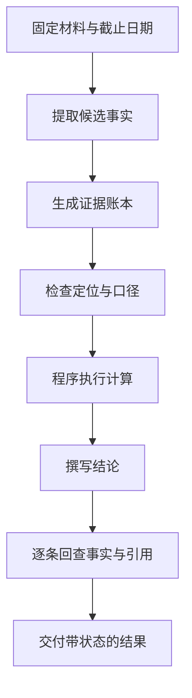

# Kimi K3.1 Pro 的事实准确性：从回答分数走到证据账本

研究型 Agent 的输出往往混合了检索、计算和解释。一段流畅的结论里，可能同时包含正确引用、过期数据和没有依据的推断。要判断它能否用于实际工作，需要把这些成分拆开。

Kimi 的[官方技术介绍](https://www.kimi.com/en/blog/kimi-k3-1-pro)报告：在内部 Kimi Hallu Bench Hard 压力测试中，K3.1 Pro 的单项事实陈述错误率由 K3 的 23.4% 降至 8.3%。官方同时说明，这组高难度样本的错误率不代表日常使用的整体水平。

公开材料提供的是专项优化结果，未展开完整训练方法。本文据此讨论应用侧怎样定义事实、组织证据和执行验收；下面的账本、数据与检查流程均为本文构造。

## 两种错误率有不同的分母

单项陈述错误率可以抽象为：

$$
E_{\text{claim}}=\frac{\text{错误的事实陈述数}}{\text{被评估的事实陈述数}}
$$

回答级错误率则关心整条回答是否含有至少一个错误：

$$
E_{\text{response}}=
\frac{\text{至少包含一处错误的回答数}}{\text{被评估的回答数}}
$$

一条回答包含的事实越多，两个指标就越可能出现较大差异。做一个自造算例：假设每条陈述独立地有 5% 错误概率，一条回答包含 10 条陈述，至少出错一次的概率为 $1-0.95^{10}\approx40.1\%$。真实陈述通常相关，这里只是说明分母和输出长度的重要性。

因此，比较模型时，要同时看任务、事实拆分方式、是否使用工具、输出长度和判定标准。把某个压力集的单项错误率直接理解为“所有日常回答的可靠度”，会改变原指标的含义。

## 先建立可以逐条追溯的陈述

考虑一句话：“A 公司 2025 年收入达到 120 亿元，同比增长 20%，说明其增长质量明显改善。”

这句话至少包含四种内容：主体与会计期间、收入数值、增长率，以及对增长质量的判断。前三者需要不同的证据与计算，最后一项还需要定义“质量”的判据。

在输出前，可以把它拆成一个证据账本：

| 陈述 | 需要的证据 | 额外检查 |
| --- | --- | --- |
| 2025 年收入为 120 亿元 | 报告中的对应表格 | 主体、期间、合并口径与单位 |
| 2024 年收入为 100 亿元 | 可比较的上期数据 | 是否重述、口径是否一致 |
| 同比增长 20% | 上述两项与计算过程 | 分母与公式是否正确 |
| 增长质量改善 | 事先定义的分析条件 | 不能仅由收入增速推出 |

这里的公司和数值完全是示例。账本的作用是保留推理边界，让读者看清哪些是来源事实，哪些是计算，哪些是进一步解释。

## 证据要能定位到实际材料

一个最小记录可以包含：

```json
{
  "claim_id": "demo-revenue-2025",
  "metric": "revenue",
  "value": "120",
  "unit": "亿元",
  "period": "FY2025",
  "scope": "consolidated",
  "source": {"document_id": "demo-report", "page": 17},
  "status": "pending"
}
```

这个 schema 是本文的应用设计。文档 ID 应绑定到一份可重取的材料，必要时记录内容摘要和获取时间。页码应能帮助人工找到对应位置，而不只是让引用看起来完整。

对于网页材料，还要关注内容是否会变更。对于 PDF，要区分文件页序号和印刷页码。对于截图或扫描表格，要保留图像证据，并检查 OCR 是否把负号、小数点或单位识别错了。

格式正确只说明记录符合 schema。来源是否包含该信息、信息是否被正确理解，仍需单独验证。

## 把可确定的计算交给确定性程序

已经确认口径一致的数值，可以由普通程序计算。这样更容易复查，也便于在来源发生变化时重算。

```python
from decimal import Decimal

def growth_rate(current, previous):
    keys = ("unit", "scope", "metric")
    if any(current[k] != previous[k] for k in keys):
        raise ValueError("incomparable accounting basis")
    denominator = Decimal(previous["value"])
    if denominator <= 0:
        raise ValueError("growth needs separate interpretation")
    return (Decimal(current["value"]) - denominator) / denominator

base = {"unit": "亿元", "scope": "consolidated", "metric": "revenue"}
current = {**base, "value": "120"}
previous = {**base, "value": "100"}
assert growth_rate(current, previous) == Decimal("0.2")
```

这段示例验证的是一致口径下的算术。会计期间是否可比、是否存在追溯调整、两项数值是否来自同一业务范围，仍需要在计算前检查。

分母为零或负数时，增长率的通常表达可能失去直观含义，示例选择交回单独解释，而不生成一个形式上正确却可能误导的百分比。

## 让核验阶段获得独立的输入



核验器应直接访问材料和陈述清单，而不只是阅读生成阶段的一段自我解释。否则，同一个误读可能沿着生成、总结、核验一路复制，最后获得几次相似的肯定回答。

对“材料支持”“材料反驳”“当前材料无法判断”，也应保留不同状态。证据不足不自动等于事实为假；对于必须有依据才能交付的任务，它意味着这条结论尚未通过验收。

## 评估时保留覆盖率、错误率和拒答行为

一个只通过少说话来降低错误率的系统，未必更有用；一个把所有空白都补满的系统，也可能扩大未经支持的内容。

所以应同时观察：问题覆盖程度、关键事实的证据覆盖率、已判定陈述的正确率、计算可复现性，以及面对缺失材料时能否明确保留不确定状态。

样本还应包含难例：报告口径变化、相同指标的不同期间、同名主体、单位混用、图表与正文不一致、以及搜索结果中看似相关却没有支持结论的页面。

冻结材料、规定截止日期、保存执行轨迹，可以帮助区分模型理解能力与临时检索差异。对于公开基准，应按其原始口径阅读厂商报告，避免把不同工具、不同样本和不同评分方式的数字混排成同一张能力榜。

K3.1 Pro 报告的事实准确性提升，为这类工作流提供了值得验证的模型候选。应用能否可靠交付，还取决于它怎样保存证据、处理计算与表达尚未确认的结论。

## 资料与后续阅读

- [Kimi K3.1 Pro 官方技术介绍：Hallu Bench Hard 及适用范围说明](https://www.kimi.com/en/blog/kimi-k3-1-pro)
- [官方模型卡：评测表及脚手架说明](https://huggingface.co/moonshotai/Kimi-K3.1-Pro)
- 本系列：[长上下文与消息协议](/posts/kimi-k31-pro-context-api) · [3D 任务中的独立验收](/posts/kimi-k31-pro-cad-tool-loop)

*资料核验于 2026-11-05。文中公司、数值、代码与流程为解释技术问题构造，不是投研报告或 Kimi 实测。*
