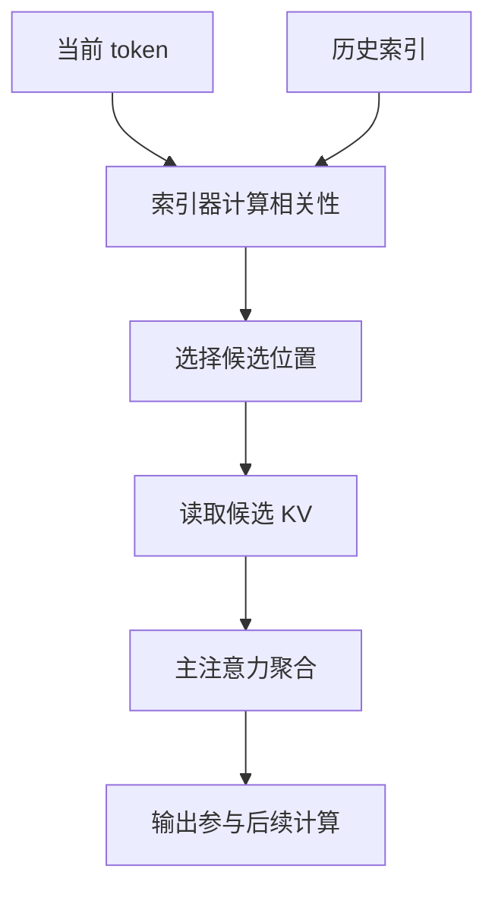

# Kimi K3.1 Pro 的 Gated DSA：百万上下文怎样少读历史

Kimi K3.1 Pro 的官方模型卡披露了一项值得单独分析的架构变化：保留 69 层 Kimi Delta Attention（KDA），将 K3 的 24 层 Gated MLA 换成 Gated DeepSeek Sparse Attention（Gated DSA）。[模型卡](https://huggingface.co/moonshotai/Kimi-K3.1-Pro)与[配置文件](https://huggingface.co/moonshotai/Kimi-K3.1-Pro/blob/main/config.json)都能核对这件事。

这让百万上下文的成本问题变得更具体：线性注意力负责把历史压进状态，另一部分层负责按需回看历史；后者现在也开始先筛选、再读取。

本文先解释已公开的结构，再用通用成本模型分析它的工程含义。推导不代表对 K3.1 Pro 的性能实测。

## 从两种记忆方式看混合注意力

KDA 维护有限大小的递推状态。输入越来越长时，状态本身不会按相同速度增长，但模型必须把越来越多的信息编码进同一块记忆。需要精确回找原文时，这种压缩会受到约束。

显式注意力提供另一种能力：保留历史位置，在当前 query 到来时重新读取。它能访问具体 token，访问成本也会随历史变长。

| 版本 | 递推记忆部分 | 显式访问历史的部分 |
| --- | --- | --- |
| K3 | 69 层 KDA | 24 层 Gated MLA |
| K3.1 Pro | 69 层 KDA | 24 层 Gated DSA |

K3 的组成可见[原始仓库](https://github.com/MoonshotAI/Kimi-K3)。KDA 的具体递推机制，站内已有[专文](/posts/kimi-delta-attention)，这里集中讨论显式访问这一侧的变化。

## DSA 把一次读取拆成两步

[DeepSeek-V3.2 技术报告](https://arxiv.org/html/2512.02556v1#S2.SS1)给出的 DSA 原型包含索引器和 token 选择：先为历史位置计算较便宜的相关性分数，再让主注意力处理选出的候选。

用一个抽象形式表达：

$$
\mathcal S_t=\operatorname{TopK}_{s\leq t}(I_{t,s}),\qquad
o_t=\operatorname{Attention}\big(q_t,\{k_s,v_s:s\in\mathcal S_t\}\big)
$$

索引器回答“哪些位置值得读”，主注意力回答“读到的内容怎样组合”。筛选分数和最终注意力权重承担不同工作，前者不能直接替代后者。

K3.1 Pro 配置里的 `index_topk` 为 2048，索引头数量为 32，每头维度为 128。`dsa_layers` 列出了第 4、8、12……92 层及第 93 层，末尾存在相邻的 DSA 层，不能把整个网络机械地画成完全相同的四层循环。

`Gated DSA` 中的门控、DSA 的历史位置选择、MoE 的专家路由是不同层面的控制。模型卡确认了模块名称，本文不据此补写未经核实的门控公式或训练细节。

## 2048 个候选的收益要分开计算

假设历史长度达到 $T=1{,}048{,}576$，每次选择 $k=2048$ 个位置，那么候选比例是：

$$
\frac{k}{T}=\frac{2048}{1{,}048{,}576}=\frac{1}{512}\approx0.195\%
$$

这描述的是候选规模。完整解码时间还包含索引打分、Top-k、候选搬运、主注意力、MoE 以及设备间通信。把比例直接换算成整模型 512 倍加速，会把这些部分全部漏掉。

可以把一层的时间拆成：

$$
t_{\text{layer}}=
t_{\text{index}}+t_{\text{select}}+t_{\text{gather}}+
t_{\text{attention}}+t_{\text{other}}
$$

当主注意力开销下降，索引扫描、稀疏 gather 和同步可能成为更显眼的瓶颈。吞吐测试应分别记录这些阶段，才能知道下一步该优化索引器、内存布局还是通信。

对于扫描整个前缀的 DSA 原型，单步索引仍依赖前缀长度。逐位置做 prefill 时，这部分工作也不能因为主注意力只选固定数量的候选，就自动获得严格线性复杂度。实际实现需要单独分析批处理、内核和调度。

## 稀疏读取并不自动缩小缓存

当前 query 没选中的 token，可能会被后面的 query 选中。只根据本轮 Top-k 就删除其他历史，会改变模型可访问的信息。

因此要区分三个量：历史保留量、单次读取量、当前计算量。DSA 直接改变的是后两者，缓存驻留与回收仍需要独立的设计。

做一个纯粹的容量演算：假设 24 层各为每个历史 token 保留 512 个 BF16 元素，那么一百万级 token 对应：

$$
24\times1{,}048{,}576\times512\times2\ \text{bytes}=24\ \text{GiB}
$$

这里的 512 维与 BF16 是演算假设，不是完整 K3.1 Pro 缓存规格；公式也未计入位置相关分量、索引键、分页元数据、临时缓冲和模型权重。它说明：单次访问变少，与所有历史占用变少，需要分别举证。

## 检索质量会成为一条新的误差路径

稀疏注意力增加了一道候选选择。假设模型需要回找一条接口限制，而限制所在的位置没有进入候选集，后面的主注意力就无法通过这一次读取直接使用它。

这提示我们评估时应拆开几个问题：关键证据有没有被选中、被选中的证据是否被正确使用、压缩状态是否保留了相关信息，以及最终回答是否满足约束。最终分数相同，内部失败原因可能不同。

一组有价值的验证任务，可以保持问题与答案不变，只调整证据位置、干扰文本、跨段引用距离与上下文长度。这样更容易区分定位困难和推理困难。对长代码仓库，还应验证模型能否同时找到定义、调用方和回归测试，而非只找到一个包含关键词的文件。

## 部署时值得单独记录的指标

| 观察项 | 要回答的问题 |
| --- | --- |
| Prefill 吞吐与峰值显存 | 长输入能否稳定进入模型 |
| 解码延迟随上下文长度的曲线 | 索引与历史访问是否成为瓶颈 |
| 关键证据位置的敏感性 | 稀疏选择是否影响定位 |
| 并发下的 P95 延迟 | gather、通信和调度是否放大尾延迟 |
| 完整任务的交付率 | 内核收益能否传递到工具工作流 |

测试要固定推理强度、输出预算、精度与工具环境，并把候选选择带来的收益和模型其他部分的成本分开。K3.1 Pro 这次公开的架构变化，最值得关注的是两种记忆方式如何协作，以及显式回看历史的成本怎样被重新安排。

## 资料与后续阅读

- [Kimi K3.1 Pro 官方模型卡](https://huggingface.co/moonshotai/Kimi-K3.1-Pro)
- [官方 config.json：层分布与 DSA 索引配置](https://huggingface.co/moonshotai/Kimi-K3.1-Pro/blob/main/config.json)
- [DeepSeek-V3.2：DSA 原型与训练说明](https://arxiv.org/html/2512.02556v1)
- [Kimi K3 原始仓库](https://github.com/MoonshotAI/Kimi-K3)
- 本系列下一篇：[联合强化学习怎样支撑长程 Agent](/posts/kimi-k31-pro-joint-rl-agent)

*资料核验于 2026-11-05。结构事实来自官方资料；成本演算与评估建议为本文分析。*
