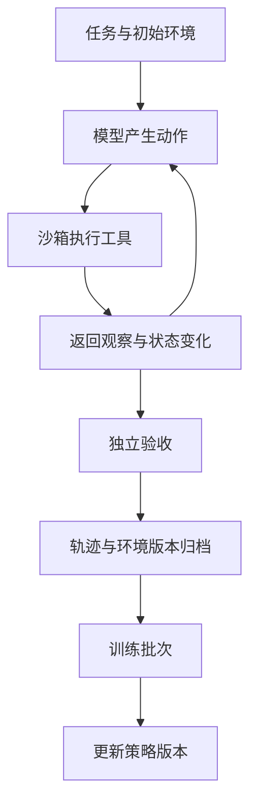

# Kimi K3.1 Pro 的联合强化学习：把长程任务变成可靠的训练信号

Kimi 对 K3.1 Pro 的[官方介绍](https://www.kimi.com/en/blog/kimi-k3-1-pro)强调了后训练规模：在数百个下游领域开展联合强化学习，并同步优化 RL 框架、长上下文推理、沙箱、rollout 调度与环境质量检查。

这段信息说明，能力提升需要一套能够持续产生有效反馈的系统。模型完成一次任务，要经历工具执行、环境变化、结果验证和训练样本归档；这些环节的质量，决定了新增算力能换回多少可学习的经验。

公开材料没有展开完整优化器与调度实现。下面用通用的系统模型解释其中的瓶颈，图和公式均为工程分析，不代表 Kimi 内部实现。

## 先明确一次 rollout 包含什么

在多步任务中，一条轨迹可以写成：

$$
\tau=(o_0,a_0,o_1,a_1,\ldots,o_n,r)
$$

$o_i$ 是观察，可能是终端输出、页面截图或工具结果；$a_i$ 是模型的动作；$r$ 是验收后得到的反馈。

对代码任务，轨迹还对应一份持续变化的工作目录。模型安装了什么依赖、修改了哪些文件、当前数据库处于什么状态，都影响后续动作的含义。只有对话文本而没有环境状态，很难重现一次成功或失败。



## 联合训练首先要处理领域之间的差异

把多个领域放在一起，可以抽象为一个加权目标：

$$
J(\theta)=\sum_{d\in\mathcal D}w_d\,
\mathbb E_{\tau\sim\pi_\theta,E_d}[R_d(\tau)]
$$

这是解释问题的简化目标，不是 K3.1 Pro 公布的损失函数。它把两个常被忽略的选择摆到台面上：每个领域分配多少机会，以及不同领域的奖励怎样比较。

代码任务可能由测试套件验收，建模任务可能由实体几何约束验收，文档任务可能要检查引用和数值。在这些任务里，奖励为 1 的条件未必具有相同难度，产生一个样本的时间也可能差几个数量级。

如果只按完成数量混合，短任务更容易占满训练批次。如果只追求高奖励，又可能不断采样模型已经熟悉的简单任务。领域权重、任务难度和实际运行成本需要同时观察，才能看清所谓“联合”到底给模型带来了哪些经验。

## 算力利用率要连同反馈有效率一起算

一个可用于容量规划的指标是：

$$
\text{有效轨迹吞吐}=\text{每小时完成轨迹数}\times
\text{环境有效率}\times\text{可判定比例}
$$

例如，假设两个系统都运行一小时：

| 系统 | 完成轨迹 | 环境有效率 | 可判定比例 | 有效轨迹估算 |
| --- | ---: | ---: | ---: | ---: |
| A | 1000 | 60% | 80% | 480 |
| B | 800 | 95% | 95% | 722 |

这是本文构造的算例。B 的表面吞吐更低，却能提供更多可用反馈。若只盯着生成速度和 GPU 利用率，就很容易把坏环境和无效验收制造的浪费当成模型学习效率。

环境失效应单独归类。依赖源失联、许可证弹窗、数据文件缺失，与模型写错代码不是同一种失败。将它们混成一个负奖励，会污染能力诊断，也会让任务难度统计失真。

## 验收器必须能抵抗“看起来完成了”

模型生成了测试报告，不等于测试通过。模型修改了验收脚本后获得成功，也不一定满足原始任务。

以数据库迁移为例，验收应从固定入口独立执行：旧数据能否保留、唯一约束是否生效、回滚是否可用、接口是否仍能处理旧客户端。工作区内的说明文档和模型的完成声明，可以成为线索，不能直接充当通过判据。

一条轨迹至少应能追溯这些信息：

```json
{
  "task_id": "demo-migration-017",
  "environment_version": "fixture-v3",
  "policy_version": "checkpoint-demo",
  "verifier_version": "checks-v2",
  "termination": "completed",
  "artifact_digest": "sha256:...",
  "verification": "passed"
}
```

这是本文建议的记录格式。环境版本帮助排除基础设施变化，验收器版本帮助定位评分口径变化，产物摘要则能把反馈绑定到被检查的那份实际输出。

## 长程任务需要可恢复的进度

考虑一个直观的概率模型：若每一步正确率都是 99%，并且错误彼此独立，100 步全部正确的概率只有 $0.99^{100}\approx36.6\%$。这不是模型实测，也不意味着真实错误独立；它说明，任务拉长后，恢复和纠错能力会变得很重要。

可靠的长程执行需要保留已验证的进度。修复最后一处测试失败时，最好能够知道前面哪些模块已经通过，而不是把整项任务重新解释一遍。

快照也必须包括与任务相关的环境变化。仅恢复对话和几份源代码，未必能恢复依赖、服务状态和生成产物。近期公开的 [SPROUT 论文](https://arxiv.org/abs/2610.14405)将上下文与文件系统的联合快照用于长程软件任务，提供了一条可对照的研究路线；它不是 Kimi 采用同一实现的证据。

## 调度效率与样本新鲜度需要一起评估

任务长度不一，严格等待所有轨迹结束，会让短任务空等。让不同任务异步推进，又会带来策略版本差异：某条很长的轨迹生成到一半时，训练端可能已经更新多次。

因此，一个可观察的 rollout 系统应记录轨迹使用的策略版本、等待时间、运行时间和中断原因。是否丢弃过旧轨迹、是否允许从快照分支、怎样形成训练批次，都是需要实验回答的实现问题。

对联合训练，最终还要看领域间的相互影响。整体平均分提高时，应检查某些领域是否退化，长任务是否被短任务挤出，以及奖励较容易获得的任务是否消耗了不成比例的预算。

## 将同一思路用于自己的 Agent

即使不训练模型，也能从这套分析里获得直接收益：把任务拆成可验收的阶段，为每个阶段记录产物和工具反馈；区分工具故障与推理错误；对高成本操作保存可恢复状态；用最终产物检查代替完成声明。

K3.1 Pro 的联合 RL 方向值得关注，正是因为这些环节连接了训练与交付。工程上应继续追踪公开材料中的环境定义、验收方法和训练消融，而不只看一个合并后的总分。

## 资料与后续阅读

- [Kimi K3.1 Pro 官方技术介绍：联合 RL 与基础设施方向](https://www.kimi.com/en/blog/kimi-k3-1-pro)
- [SPROUT：长程软件任务中的快照与 rollout 复用](https://arxiv.org/abs/2610.14405)
- 本系列：[Gated DSA](/posts/kimi-k31-pro-gated-dsa) · [长上下文 API 接入](/posts/kimi-k31-pro-context-api)

*资料核验于 2026-11-05。表格、概率演算与记录格式为本文构造，未将其作为 Kimi 的训练日志或内部实现。*
